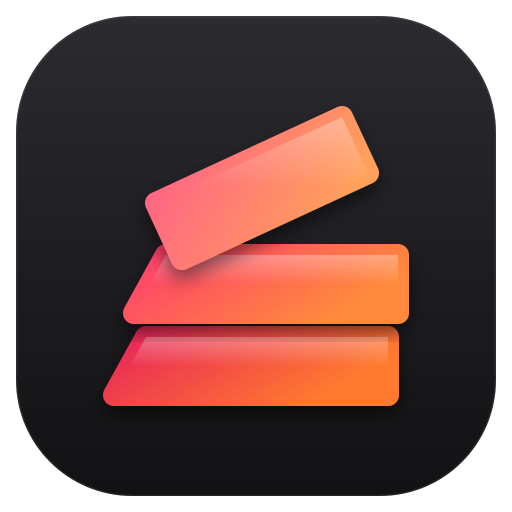
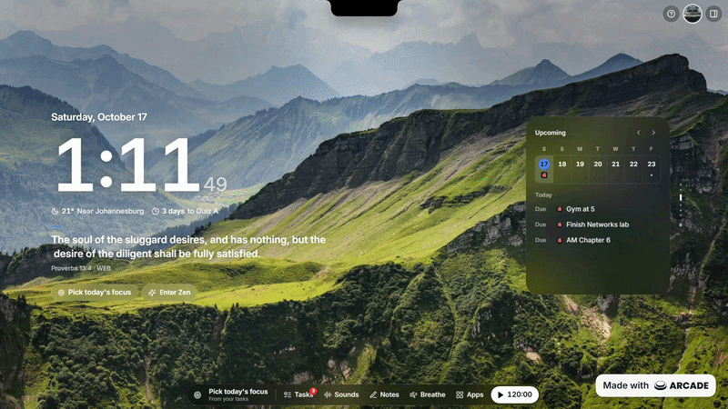
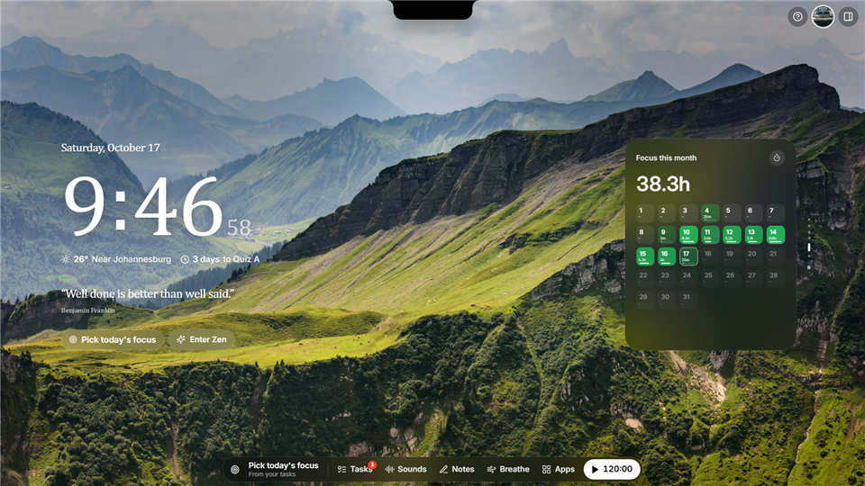
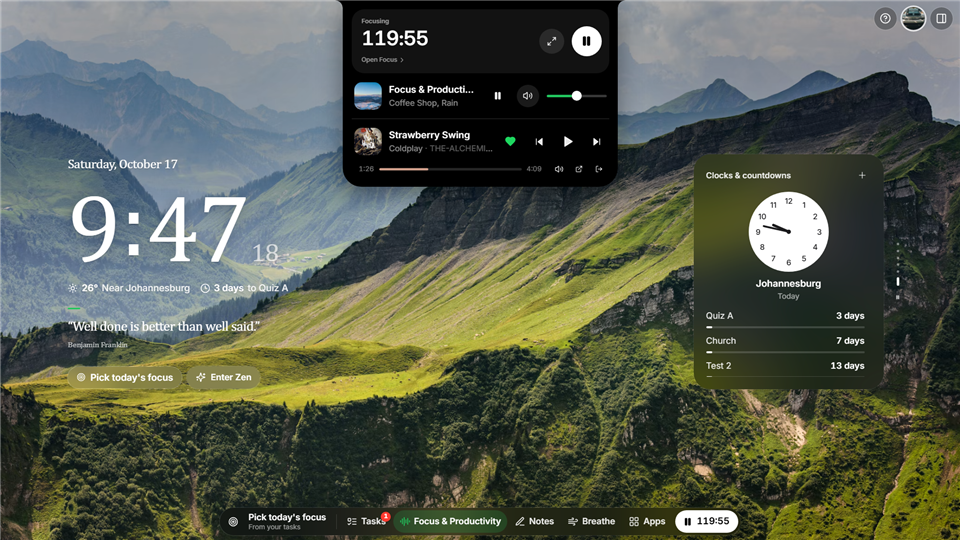
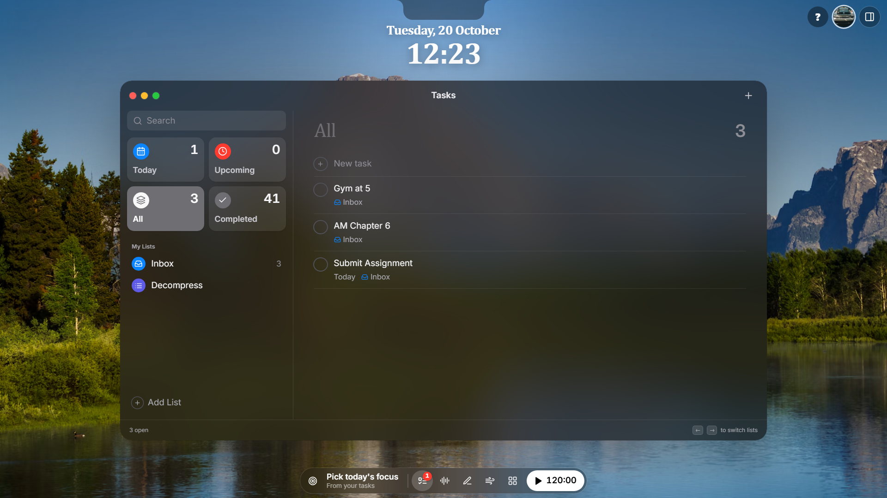
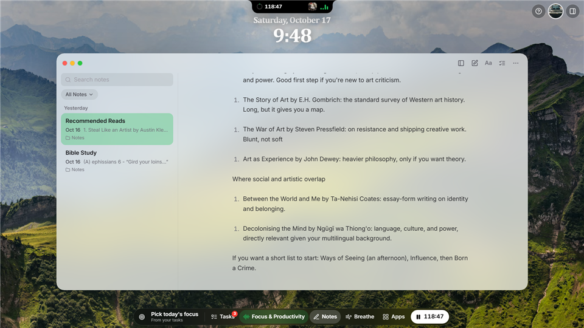
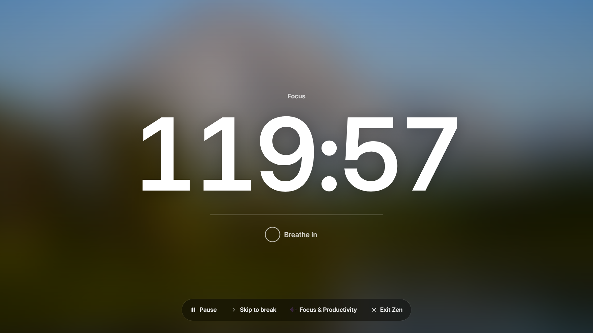
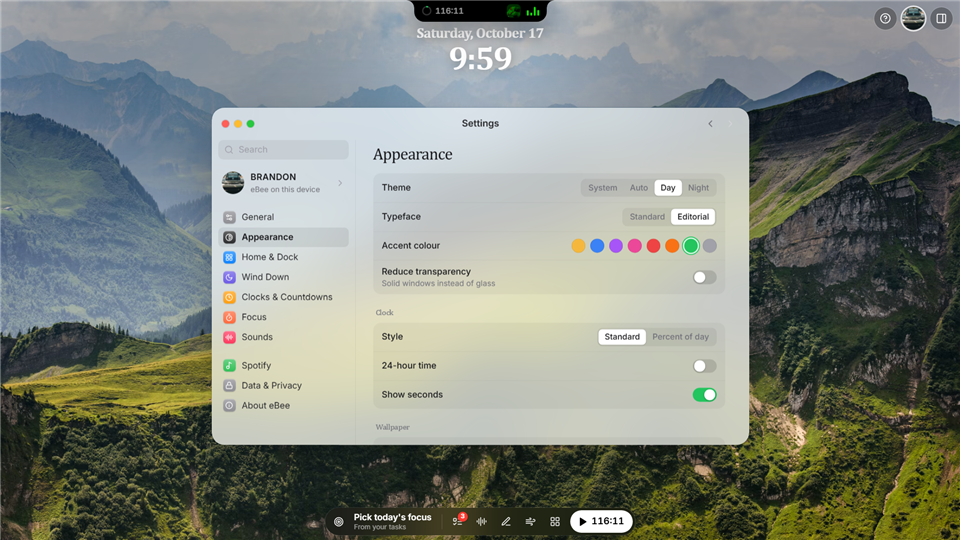
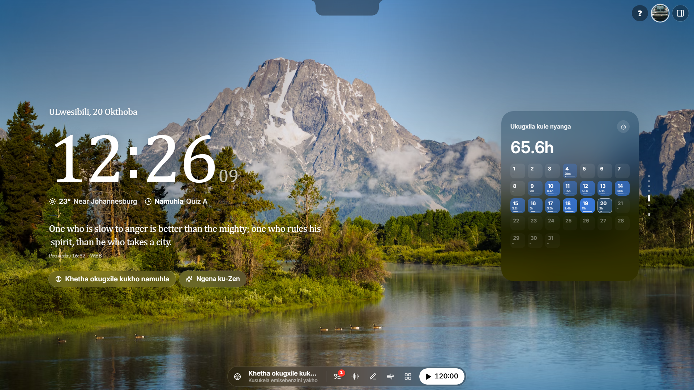

# eBee

**A calm, macOS-inspired focus space that lives in every new browser tab.**

> **A personal project.** eBee isn't published or distributed; it's the new tab I use every day.
> This repository is a showcase: the source code is private.
> Happy to walk through the code and architecture on request: [github.com/Alch3mist-42](https://github.com/Alch3mist-42).

> 📄 **[Architecture and design decisions](EBEE_ARCHITECTURE.md)** — what was built, why each approach was chosen, and what was rejected.

## What it does

| | |
| --- | --- |
| 🎧 **Dynamic Island** | A notch at the top of the screen for the focus timer, ambient soundscapes and Spotify, with mute, song-change peeks and calendar reminders. It expands on hover, and its colours follow the album art. |
| 📝 **Notion-style notes** | A block editor with real formatting (no visible markup), photos stored as real files, slash commands, block menus, checklists, collapsible sections, note linking and AES-256 locking. |
| 🪟 **macOS-style windows** | Tasks, Notes, Habits, Sounds, Calendar, Wallpaper, Links, Site Blocker, Shortcuts and Settings, with traffic-light controls, dragging and zoom. |
| 🃏 **Card stack** | Weather, today's tasks, upcoming events, habits, focus this month and world clocks, as a one-card-per-minute slideshow with continuous scrolling. |
| ⏱️ **Focus & Zen** | A Pomodoro timer that keeps running across views, a pop-out timer window that floats above every other window, full-screen Zen with a breathing guide, and a Wind Down mode for the evening. |
| 🛡️ **Site blocker** | Blocks distracting sites always or only during focus, with a calm blocked page and strictly limited bypasses. |
| 🎨 **Personal** | Eight accent colours, a Standard or Editorial typeface, a day/night clock face, saved custom wallpapers and a rotating greeting line. |
| 🌍 **Nine languages** | Fully translated into English, isiZulu, Español and 中文, with navigation in five more. Chrome has no isiZulu date names, so eBee supplies its own: "UMgqibelo, 17 Okthoba". |
| 🔒 **Offline-first** | No accounts, no servers. Everything is stored in the browser (IndexedDB and localStorage). |

## A closer look

### The home screen

### The Dynamic Island

### Notes

### Tasks

### Zen mode and personalisation

### isiZulu

## Built with

TypeScript · React 18 · Tailwind CSS · Framer Motion · Zustand · Dexie (IndexedDB) · TipTap · Chrome Extension Manifest V3 (WXT) · Vitest · browser-based end-to-end validators

## What I learned building it

- **Measuring beats guessing.** Animations flickered when windows opened. Rather than guess, I recorded every frame and tracked brightness over time: a smooth fade moves in one direction, a flicker shows as a reversal. Six reversals before, zero after. One cause turned out to be a rendering quirk in the animation library, not my own code.
- **Tests can pass while the feature is broken.** Pasted photos in notes kept corrupting. My tests used small, clean images and passed every time. The real cause was buried in the foundation: notes were being silently truncated at 10,000 characters, and a photo is hundreds of thousands. Realistic test data would have caught it on day one.
- **Thinking adversarially.** I audited eBee the way a security reviewer would, asking what a malicious website, another extension or an automated agent could make it do, and fixed clickjacking, message isolation, a missing content security policy, and a way to abuse the site blocker's bypass.
- **Verifying AI-assisted work.** I used AI heavily to move fast during an exam week while owning every product and design decision, and verified each change with tests, type checking and measurement.
- **Testing what matters.** 332 unit tests, plus browser validators that drive the real extension through the timer, site blocker, greeting, wallpaper and breathing flows.

## Built on Meelio

eBee is built on **[Meelio](https://github.com/zainzafar90/meelio)**, an open-source new-tab app by Zain Zafar (MIT License), which gave me a solid foundation to design on top of.

## Ownership

© 2026 Thando Shabangu. eBee's own design, features, name and logo are all rights reserved. Meelio's code remains under its MIT License. eBee is not affiliated with or endorsed by Meelio or Spotify.
